# VestCare — Pengembangan YOLO26n-seg (Tahap 6–8)

Eksperimen segmentasi objek jalan untuk penunjang tunanetra (rompi VestCare).
Repo ini memuat perbandingan **YOLO11n-seg vs YOLO26n-seg** (tahap 6), pelatihan
model final (tahap 7), dan evaluasi mendalam model final pada test asli (tahap 8).

Kelas: **pohon, lubang, orang, motor, mobil**. Semua angka di halaman ini diambil
langsung dari file CSV/JSON/TXT di [`hasil_06/`](hasil_06/), [`hasil_07/`](hasil_07/),
dan [`hasil_08/`](hasil_08/).

Dokumentasi lengkap: [laporan lengkap](docs/LAPORAN_LENGKAP.md) ·
[dataset](docs/DATASET.md) · [galeri semua grafik](docs/GALERI.md) ·
[requirements](requirements.txt).

---

## Ringkasan cepat

| Tahap | Isi | Hasil kunci (test asli) |
|---|---|---|
| 6 | 2 model × 3 seed split, rasio 80 | yolo26n-seg mask mAP50-95 **0.2945 ± 0.0368** vs yolo11n-seg **0.2388 ± 0.0330** (+0.0557) |
| 7 | Latih ulang pemenang di train+val, 100 epoch | yolo26n-seg r80 s44: mask mAP50-95 **0.2878**, box mAP50-95 **0.4028**, image-level per kelas akurasi 0.8907–1.0000 |
| 8 | Evaluasi mendalam `models/best.pt` | akurasi tingkat gambar **0.8721 (375/430)**, F1-mikro **0.8863**, F1-makro **0.8643**, kecepatan **21.01 ms/gambar (~47.6 FPS)** |

## Dataset

Split resmi `split_r80_s44` (rasio 80, seed 44):

| Split | Gambar | Instance |
|---|---:|---:|
| Train | 3.060 | 6.465 |
| Val | 770 | 1.440 |
| Test | 430 | 905 |
| **Total** | **4.260** | **8.810** |

Test set terdiri dari 5 varian seimbang (86 gambar/varian): `asli`,
`gerak_diagonal`, `gerak_horizontal`, `gerak_vertikal`, `getar`.
Rincian per kelas/varian: [`docs/DATASET.md`](docs/DATASET.md).

---

## TAHAP 6 — Perbandingan `yolo11n-seg` vs `yolo26n-seg`

Membandingkan kedua model pada dataset yang sama, hiperparameter identik, lalu
mengevaluasi bobot terbaik pada split **val** dan **test**.

### 6.1 Pengaturan eksperimen

| Parameter | Nilai |
|---|---|
| Model | `yolo11n-seg.pt`, `yolo26n-seg.pt` (bobot pralatih Ultralytics) |
| Kelas | pohon, lubang, orang, motor, mobil |
| Rasio split train/val/test | 80 (sisa val+test) |
| Seed split | 43, 44, 46 (**3 ulangan** per model) |
| Epoch | 10, `patience` 30 |
| `imgsz` / `batch` | 416 / 1 |
| Seed latih | 0, `deterministic=True` |
| Optimizer | resep bawaan masing-masing model (`auto`) |
| Pemilihan model/rasio | memakai skor **test** (bukan val) |

Run: 2 model × 3 seed split = **6 pelatihan**, masing-masing dievaluasi di val dan test.

### 6.2 Hasil utama per run (skor test)

| Run | mask P | mask R | mask F1 | mask mAP50 | **mask mAP50-95** | box mAP50-95 |
|---|---|---|---|---|---|---|
| yolo11n-seg · s43 | 0.5619 | 0.4443 | 0.4962 | 0.4472 | 0.2468 | 0.3100 |
| yolo26n-seg · s43 | 0.6332 | 0.5385 | 0.5820 | 0.5067 | **0.3085** | 0.3329 |
| yolo11n-seg · s44 | 0.5203 | 0.3921 | 0.4472 | 0.3476 | 0.1950 | 0.2545 |
| yolo26n-seg · s44 | 0.6600 | 0.4650 | 0.5456 | 0.4614 | **0.2441** | 0.3389 |
| yolo11n-seg · s46 | 0.6438 | 0.4771 | 0.5480 | 0.5083 | 0.2746 | 0.3748 |
| yolo26n-seg · s46 | 0.7457 | 0.5778 | 0.6511 | 0.5960 | **0.3310** | 0.4202 |

### 6.3 Ringkasan rata-rata simpangan baku lintas 3 seed (rasio 80)

#### 6.3.1 Skor test (akurasi)

| Model | mask mAP50-95 | mask mAP50 | mask P | mask R | mask F1 |
|---|---|---|---|---|---|
| yolo11n-seg | 0.2388 ± 0.0330 | 0.4343 ± 0.0662 | 0.5754 | 0.4378 | 0.4972 |
| **yolo26n-seg** | **0.2945 ± 0.0368** | **0.5214 ± 0.0559** | **0.6796** | **0.5271** | **0.5929** |
| Selisih (26n − 11n) | **+0.0557** | +0.0870 | +0.1043 | +0.0893 | +0.0957 |

| Model | box mAP50-95 | box mAP50 | box P | box R | box F1 |
|---|---|---|---|---|---|
| yolo11n-seg | 0.3131 ± 0.0491 | 0.5230 ± 0.0648 | 0.6604 | 0.4918 | 0.5634 |
| **yolo26n-seg** | **0.3640 ± 0.0398** | **0.6087 ± 0.0608** | **0.7415** | **0.5828** | **0.6517** |
| Selisih (26n − 11n) | +0.0509 | +0.0857 | +0.0811 | +0.0910 | +0.0883 |

#### 6.3.2 Skor val (untuk cek generalisasi)

| Model | val mask mAP50-95 | val mask mAP50 | val box mAP50-95 | selisih val − test |
|---|---|---|---|---|
| yolo11n-seg | 0.2622 ± 0.0218 | 0.5246 ± 0.0369 | 0.3502 ± 0.0123 | +0.0234 |
| yolo26n-seg | 0.3306 ± 0.0094 | 0.5881 ± 0.0195 | 0.3994 ± 0.0347 | +0.0361 |

Gap val–test kecil (< 0.04), sehingga skor test dapat dipercaya dan tidak ada
overfitting berarti.

### 6.4 Perbandingan berpasangan per split (test mask mAP50-95)

| Split | yolo26n-seg − yolo11n-seg |
|---|---|
| split_r80_s43 | +0.06170 |
| split_r80_s44 | +0.04912 |
| split_r80_s46 | +0.05635 |
| **Rata-rata** | **+0.05572 ± 0.00515** |

`yolo26n-seg` **unggul di 3 dari 3 split** (100%).

> Catatan kejujuran ilmiah: selisih konsisten dan sebanding simpangannya
> (0.0557 vs 0.0052), tetapi baru **n = 3 seed**. Untuk klaim statistik yang kuat,
> tambah seed split di tahap 5 (mis. `--seed 47 48 49`).

### 6.5 Akurasi per kelas (test mask)

#### 6.5.1 `yolo11n-seg` — mAP50-95 per seed

| Kelas | s43 | s44 | s46 | **Rata-rata** | P (rata2) | R (rata2) | mAP50 (rata2) |
|---|---|---|---|---|---|---|---|
| pohon | 0.19594 | 0.19978 | 0.18195 | **0.19256** | 0.622 | 0.309 | 0.319 |
| lubang | 0.03857 | 0.06997 | 0.16796 | **0.09217** | 0.396 | 0.285 | 0.216 |
| orang | 0.11453 | 0.14186 | 0.16139 | **0.13926** | 0.424 | 0.429 | 0.389 |
| motor | 0.52295 | 0.24308 | 0.40204 | **0.38936** | 0.720 | 0.612 | 0.648 |
| mobil | 0.36193 | 0.32013 | 0.45965 | **0.38057** | 0.713 | 0.554 | 0.599 |

#### 6.5.2 `yolo26n-seg` — mAP50-95 per seed

| Kelas | s43 | s44 | s46 | **Rata-rata** | P (rata2) | R (rata2) | mAP50 (rata2) |
|---|---|---|---|---|---|---|---|
| pohon | 0.21351 | 0.25370 | 0.23944 | **0.23555** | 0.767 | 0.368 | 0.401 |
| lubang | 0.03551 | 0.08834 | 0.21372 | **0.11252** | 0.430 | 0.248 | 0.246 |
| orang | 0.12248 | 0.19231 | 0.16981 | **0.16153** | 0.601 | 0.647 | 0.515 |
| motor | 0.75489 | 0.20599 | 0.55068 | **0.50385** | 0.787 | 0.801 | 0.761 |
| mobil | 0.41605 | 0.48008 | 0.48112 | **0.45908** | 0.814 | 0.571 | 0.684 |

#### 6.5.3 Selisih rata-rata per kelas (`yolo26n-seg` − `yolo11n-seg`)

| Kelas | yolo11n-seg | yolo26n-seg | Selisih |
|---|---|---|---|
| pohon | 0.19256 | 0.23555 | +0.0430 |
| lubang | 0.09217 | 0.11252 | +0.0204 |
| orang | 0.13926 | 0.16153 | +0.0223 |
| motor | 0.38936 | 0.50385 | +0.1145 |
| mobil | 0.38057 | 0.45908 | +0.0785 |

Kedua model paling kuat pada **motor** dan **mobil**, paling lemah pada **lubang**
(objek kecil/tipis). `yolo26n-seg` lebih unggul di **semua kelas**, terbesar pada motor.
Data mentah per run: [`hasil_06/per_kelas.csv`](hasil_06/per_kelas.csv).

### 6.6 Grafik

#### 6.6.1 Perbandingan model × rasio split (test mask mAP50-95 ± sd, dan seluruh indikator)

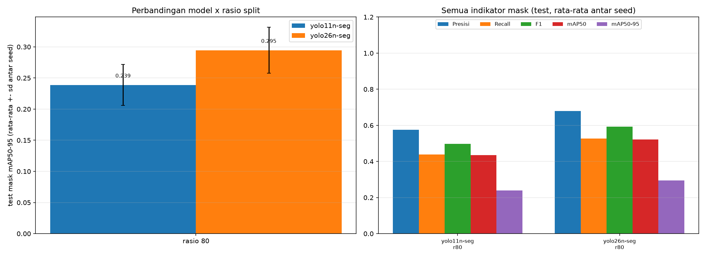

#### 6.6.2 Confusion matrix pada test (seed s46)

| yolo11n-seg | yolo26n-seg |
|---|---|
| 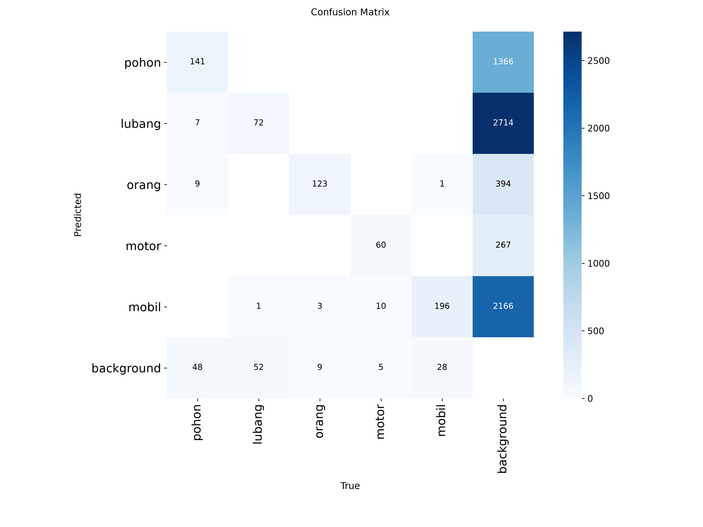 | 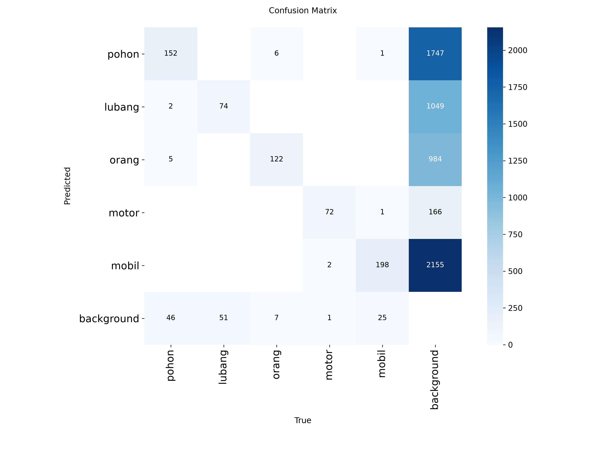 |

#### 6.6.3 Kurva PR mask pada test (seed s46)

| yolo11n-seg | yolo26n-seg |
|---|---|
| 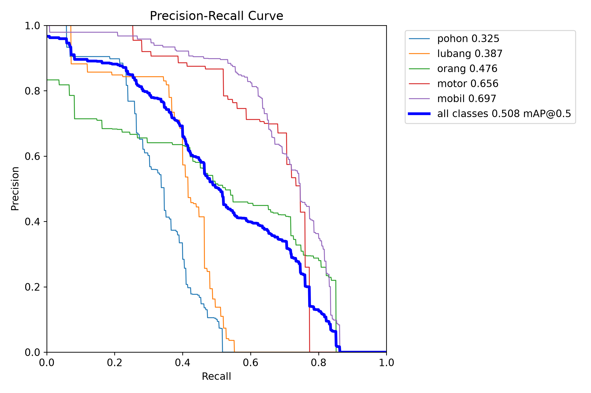 | 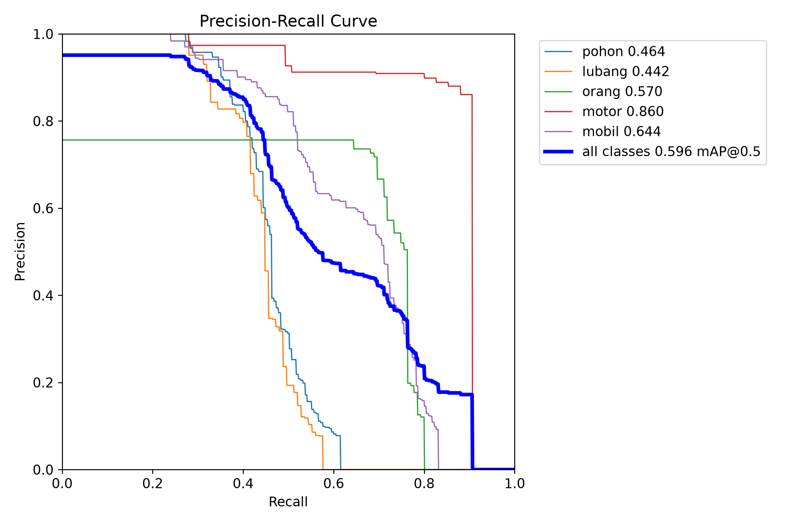 |

#### 6.6.4 Kurva F1 mask pada test (seed s46)

| yolo11n-seg | yolo26n-seg |
|---|---|
| 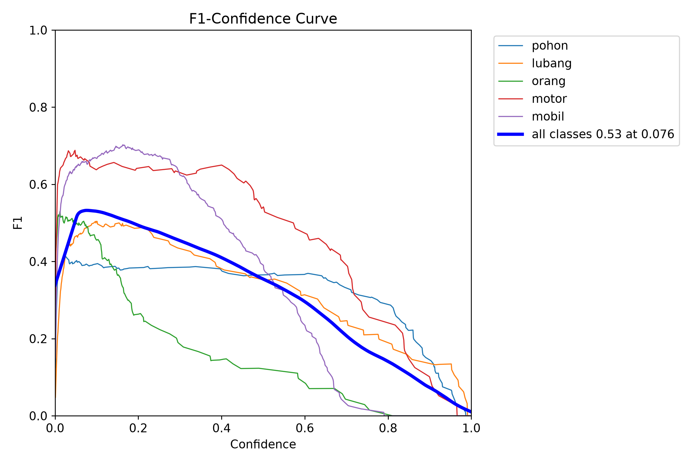 | 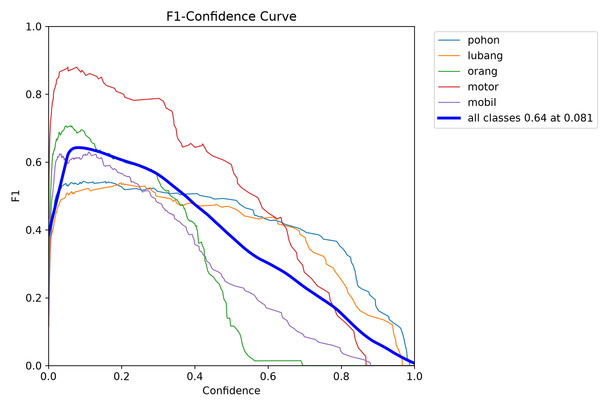 |

Grafik lain (kurva P/R, box, val, `results.png` latih per run) ada di
[`runs/segment/hasil_06/`](runs/segment/hasil_06).

### 6.7 Efisiensi

| Model | Parameter | Ukuran bobot | Waktu latih (rata2/run) | Inferensi test |
|---|---|---|---|---|
| yolo11n-seg | 2.859 juta | 5.99 MB | 46.62 menit | 14.88 ms |
| yolo26n-seg | 3.085 juta (+7.9%) | 6.57 MB (+9.7%) | 86.28 menit (+85%) | 14.56 ms |

Kecepatan inferensi **hampir sama** (~14.5–14.9 ms), yolo26n-seg lebih berat saat
latih tetapi tidak lebih lambat saat inferensi.

### 6.8 Kesimpulan tahap 6

1. **`yolo26n-seg` lebih akurat di semua metrik**: mask mAP50-95 0.2945 vs 0.2388
   (+23.3% relatif), mAP50 0.5214 vs 0.4343, F1 0.5929 vs 0.4972.
2. Keunggulan **konsisten di 3/3 split** dengan selisih rata-rata **+0.0557**.
3. Unggul di **semua 5 kelas**, terbesar pada kelas motor.
4. Biaya: latih ~2× lebih lama, parameter +7.9%, tetapi **inferensi sama cepat**
   layak dipakai untuk deployment di rompi.
5. Kelas `lubang` masih rendah (< 0.12 mAP50-95) kandidat perbaikan
   (augmentasi/annotasi khusus) di tahap selanjutnya.

### 6.9 Menjalankan ulang tahap 6

```bash
pip install -r requirements.txt
# dataset split (split_r80_s43, s44, s46) harus sudah ada di --splits-dir
python 06_bandingkan_model.py --splits-dir <folder_split> --out hasil_06 \
       --epochs 10 --imgsz 416 --batch 1
```

Run yang sudah punya JSON di `hasil_06/run_json/` otomatis dilewati (resumable).

---

## TAHAP 7 — Latih final `yolo26n-seg`

Tahap 7 mengambil pemenang tahap 6, menggabungkan **train + val**, menyisihkan
**val-internal 10%** secara berkelompok (varian dari gambar sumber yang sama dan
frame berurutan tidak dipisah), lalu melatih ulang dari bobot COCO. **Test asli
tidak pernah dipakai untuk latih/val.**

### 7.1 Pemilihan model, rasio, dan seed

| Item | Nilai |
|---|---|
| Model | **yolo26n-seg** |
| Rasio | **80** |
| Seed split | **44** (`split_r80_s44`) |
| Alasan | Model/rasio ditentukan manual dari hasil tahap 6; seed dipilih yang skornya paling dekat median (bukan yang tertinggi) |

Data final: **3.405 gambar train**, **425 gambar val-internal**, **430 gambar test asli**.

### 7.2 Konfigurasi latih

| Parameter | Nilai |
|---|---|
| Bobot awal | `yolo26n-seg.pt` (COCO) |
| Epoch | 100 |
| `patience` | 30 |
| `imgsz` / `batch` | 416 / 1 |
| Seed latih | 0, `deterministic=True` |
| Waktu latih | **42.87 menit** |
| Parameter | **3.085 juta** |
| Ukuran bobot | **6.57 MB** |
| Output bobot | [`models/best.pt`](models/best.pt) |

### 7.3 Akurasi test total (430 gambar)

| Metrik | Mask | Kotak |
|---|---|---|
| Precision | **0.6774** | **0.7883** |
| Recall | **0.5163** | **0.5951** |
| F1 | **0.5860** | **0.6782** |
| mAP50 | **0.5122** | **0.6709** |
| mAP50-95 | **0.2878** | **0.4028** |

### 7.4 Akurasi per kelas (test mask)

| Kelas | n gambar | n instance | P | R | F1 | mAP50 | mAP50-95 |
|---|---|---|---|---|---|---|---|
| pohon | 95 | 195 | 0.6063 | 0.4028 | 0.4840 | 0.4253 | 0.2841 |
| lubang | 80 | 230 | 0.7835 | 0.3783 | 0.5102 | 0.4840 | 0.2186 |
| orang | 80 | 155 | 0.5986 | 0.6832 | 0.6381 | 0.5069 | 0.2123 |
| motor | 75 | 75 | 0.6820 | 0.2574 | 0.3738 | 0.2874 | 0.1052 |
| mobil | 100 | 250 | 0.7166 | 0.8600 | 0.7818 | 0.8572 | 0.6186 |

### 7.5 Akurasi per kelas (test kotak)

| Kelas | n gambar | n instance | P | R | F1 | mAP50 | mAP50-95 |
|---|---|---|---|---|---|---|---|
| pohon | 95 | 195 | 0.7298 | 0.4848 | 0.5826 | 0.5777 | 0.3445 |
| lubang | 80 | 230 | 0.7294 | 0.3522 | 0.4750 | 0.4661 | 0.2463 |
| orang | 80 | 155 | 0.7908 | 0.9026 | 0.8430 | 0.8984 | 0.4505 |
| motor | 75 | 75 | 0.9647 | 0.3641 | 0.5287 | 0.5400 | 0.2814 |
| mobil | 100 | 250 | 0.7266 | 0.8720 | 0.7927 | 0.8725 | 0.6914 |

### 7.6 Indikator tingkat gambar (conf ≥ 0.25)

| Kelas | TP | FP | FN | TN | Akurasi | Presisi | Recall | F1 |
|---|---|---|---|---|---|---|---|---|
| pohon | 95 | 2 | 0 | 333 | 0.9953 | 0.9794 | 1.0000 | 0.9896 |
| lubang | 75 | 1 | 5 | 349 | 0.9860 | 0.9868 | 0.9375 | 0.9615 |
| orang | 80 | 0 | 0 | 350 | 1.0000 | 1.0000 | 1.0000 | 1.0000 |
| motor | 28 | 0 | 47 | 355 | 0.8907 | 1.0000 | 0.3733 | 0.5437 |
| mobil | 100 | 42 | 0 | 288 | 0.9023 | 0.7042 | 1.0000 | 0.8264 |

### 7.7 Efisiensi dan kecepatan

| Indikator | Nilai |
|---|---|
| Preprocess | 1.5 ms/gambar |
| Inferensi | 19.3 ms/gambar |
| Postprocess | 3.1 ms/gambar |
| Parameter | 3.085 juta |
| Ukuran bobot | 6.57 MB |
| Waktu latih | 42.87 menit |

### 7.8 Grafik tahap 7

| Ringkasan total | Per kelas |
|---|---|
| 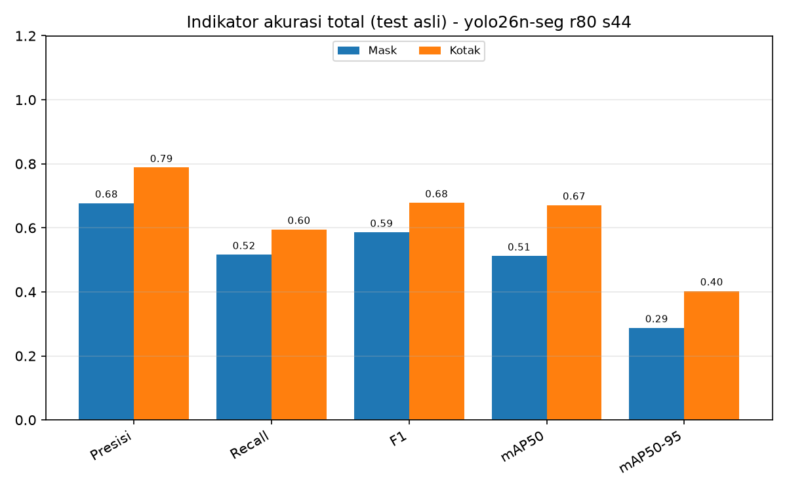 | 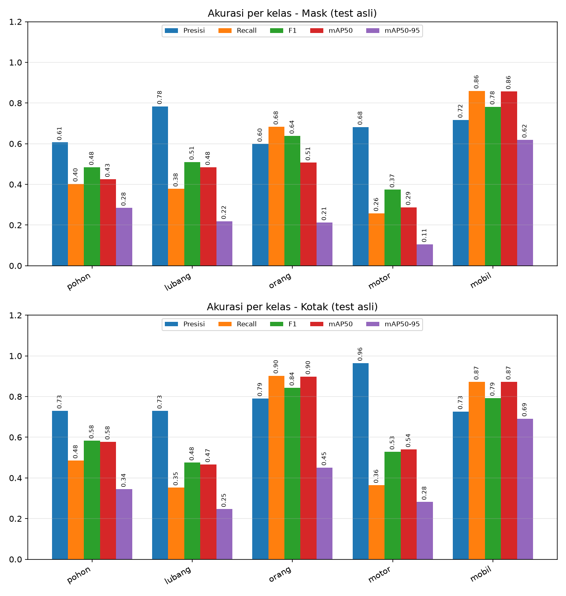 |

| Confusion matrix test | Kurva PR mask | Kurva F1 mask |
|---|---|---|
| 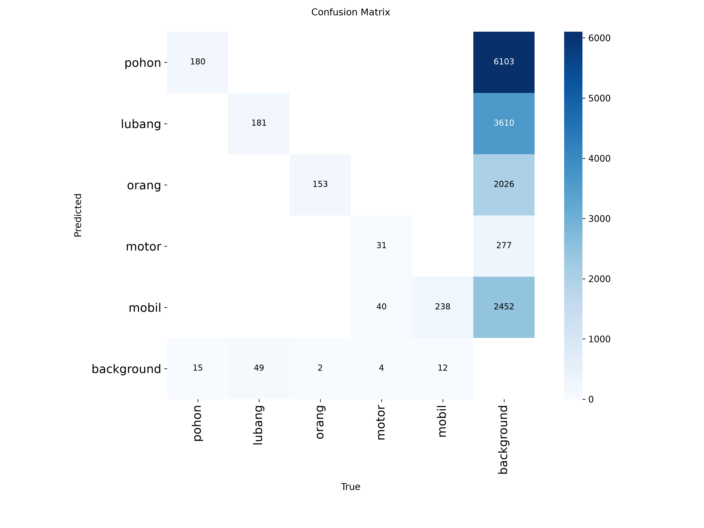 | 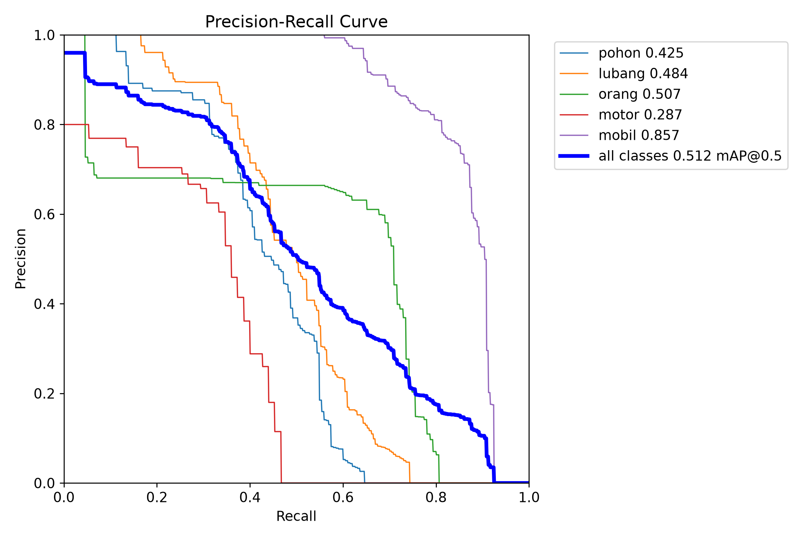 | 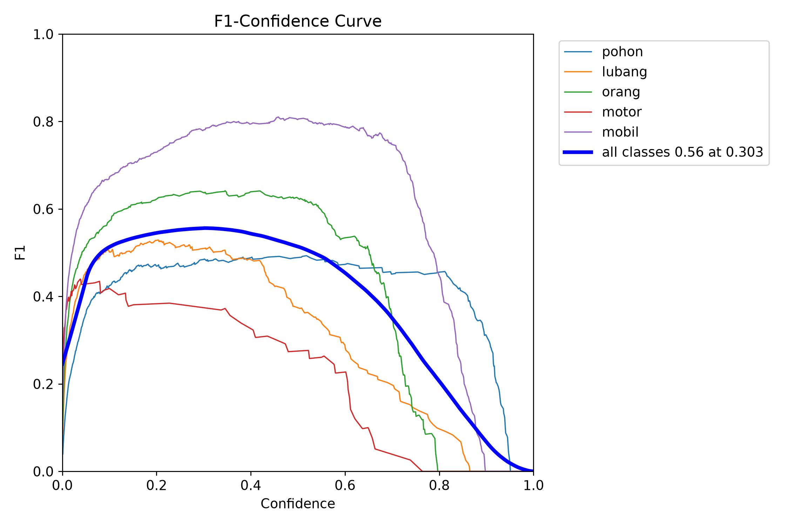 |

Kurva lengkap (box P/R/F1, mask P/R) dan `results.png` latih ada di
[`hasil_07/evaluasi_test/`](hasil_07/evaluasi_test) dan
[`hasil_07/runs/`](hasil_07/runs).

### 7.9 File hasil tahap 7

| File | Isi |
|---|---|
| [`hasil_07/pilihan_final.json`](hasil_07/pilihan_final.json) | model/rasio/seed terpilih |
| [`hasil_07/laporan_final.json`](hasil_07/laporan_final.json) | seluruh skor test + per kelas + kecepatan |
| [`hasil_07/laporan_akurasi.txt`](hasil_07/laporan_akurasi.txt) | ringkasan P/R/F1/mAP + tingkat gambar |
| [`hasil_07/per_kelas_test.csv`](hasil_07/per_kelas_test.csv) | metrik mask & kotak per kelas |
| [`hasil_07/konfusi_tingkat_gambar.csv`](hasil_07/konfusi_tingkat_gambar.csv) | TP/FP/FN/TN per kelas |
| [`hasil_07/konfusi_tingkat_gambar.png`](hasil_07/konfusi_tingkat_gambar.png) | grafik konfusi tingkat gambar |
| [`hasil_07/evaluasi_test/`](hasil_07/evaluasi_test) | confusion matrix & kurva PR dari Ultralytics |
| [`hasil_07/runs/`](hasil_07/runs) | log latih Ultralytics + `weights/best.pt` |

---

## TAHAP 8 — Evaluasi mendalam model final

Tahap 8 mengevaluasi `models/best.pt` pada **430 gambar test asli** yang sama,
ditambah pemecahan per varian gambar, analisis kesalahan tingkat gambar, contoh
prediksi benar/salah, dan pengukuran kecepatan.

### 8.1 Ringkasan akurasi test

Model: `models/best.pt` | Split: `split_r80_s44` | Gambar test: **430**

| Metrik | Mask | Kotak |
|---|---|---|
| Precision | **0.6774** | **0.7883** |
| Recall | **0.5163** | **0.5951** |
| F1 | **0.5860** | **0.6782** |
| mAP50 | **0.5122** | **0.6709** |
| mAP50-95 | **0.2878** | **0.4028** |

**Tingkat gambar (conf ≥ 0.25):**

| Indikator | Nilai |
|---|---|
| Gambar benar | **375 / 430** |
| Gambar salah | **55** |
| Akurasi tingkat gambar | **0.8721 (87.21%)** |
| Presisi mikro | **0.8936** |
| Recall mikro | **0.8791** |
| F1 mikro | **0.8863** |
| F1 makro | **0.8643** |

### 8.2 Akurasi per kelas (mask)

| Kelas | n gambar | n instance | P | R | F1 | mAP50 | mAP50-95 |
|---|---|---|---|---|---|---|---|
| pohon | 95 | 195 | 0.6063 | 0.4028 | 0.4840 | 0.4253 | 0.2841 |
| lubang | 80 | 230 | 0.7835 | 0.3783 | 0.5102 | 0.4840 | 0.2186 |
| orang | 80 | 155 | 0.5986 | 0.6832 | 0.6381 | 0.5069 | 0.2123 |
| motor | 75 | 75 | 0.6820 | 0.2574 | 0.3738 | 0.2874 | 0.1052 |
| mobil | 100 | 250 | 0.7166 | 0.8600 | 0.7818 | 0.8572 | 0.6186 |

### 8.3 Akurasi per kelas (kotak)

| Kelas | n gambar | n instance | P | R | F1 | mAP50 | mAP50-95 |
|---|---|---|---|---|---|---|---|
| pohon | 95 | 195 | 0.7298 | 0.4848 | 0.5826 | 0.5777 | 0.3445 |
| lubang | 80 | 230 | 0.7294 | 0.3522 | 0.4750 | 0.4661 | 0.2463 |
| orang | 80 | 155 | 0.7908 | 0.9026 | 0.8430 | 0.8984 | 0.4505 |
| motor | 75 | 75 | 0.9647 | 0.3641 | 0.5287 | 0.5400 | 0.2814 |
| mobil | 100 | 250 | 0.7266 | 0.8720 | 0.7927 | 0.8725 | 0.6914 |

### 8.4 Akurasi per varian gambar

Varian berasal dari nama file `<sumber>__<varian>.jpg`. `ASLI` adalah subset
gambar asli (86 gambar); `SEMUA_VARIAN` adalah seluruh gambar varian non-asli
(344 gambar). Baris `asli` di CSV sama dengan `ASLI` sehingga tidak diulang.

| Varian | n | mask P | mask R | mask F1 | mask mAP50 | mask mAP50-95 | box P | box R | box F1 | box mAP50 | box mAP50-95 |
|---|---|---|---|---|---|---|---|---|---|---|---|
| ASLI | 86 | 0.6707 | 0.5210 | 0.5865 | 0.5257 | **0.3063** | 0.8127 | 0.6086 | 0.6960 | 0.6735 | **0.4252** |
| SEMUA_VARIAN | 344 | 0.6788 | 0.5139 | 0.5849 | 0.5127 | 0.2860 | 0.7813 | 0.5908 | 0.6728 | 0.6727 | 0.4001 |
| gerak_diagonal | 86 | 0.7103 | 0.5022 | 0.5884 | 0.5290 | 0.2991 | 0.8330 | 0.5748 | 0.6802 | 0.6793 | 0.4034 |
| gerak_horizontal | 86 | — | — | — | — | — | — | — | — | — | — |
| gerak_vertikal | 86 | 0.6303 | 0.5499 | 0.5873 | 0.5375 | 0.2953 | 0.7103 | 0.6223 | 0.6634 | 0.6883 | 0.4221 |
| getar | 86 | 0.6837 | 0.5294 | 0.5967 | 0.5187 | 0.2942 | 0.7981 | 0.6121 | 0.6928 | 0.6653 | 0.4036 |

> Catatan: evaluasi per varian `gerak_horizontal` gagal karena satu file sementara
> tidak ditemukan (`hasil_08/_tmp_varian/.../lubang_171__gerak_horizontal.jpg`).

### 8.5 Indikator tingkat gambar per kelas (conf ≥ 0.25)

| Kelas | TP | FP | FN | Presisi | Recall | F1 |
|---|---|---|---|---|---|---|
| pohon | 95 | 2 | 0 | 0.9794 | 1.0000 | 0.9896 |
| lubang | 75 | 1 | 5 | 0.9868 | 0.9375 | 0.9615 |
| orang | 80 | 0 | 0 | 1.0000 | 1.0000 | 1.0000 |
| motor | 28 | 0 | 47 | 1.0000 | 0.3733 | 0.5437 |
| mobil | 100 | 42 | 0 | 0.7042 | 1.0000 | 0.8264 |

**Jumlah kesalahan per varian (total 55 gambar salah):**

| Varian | Jumlah salah |
|---|---|
| asli | 13 |
| gerak_diagonal | 10 |
| gerak_horizontal | 12 |
| gerak_vertikal | 9 |
| getar | 11 |

Pola kesalahan dari 55 gambar salah:

| Pola | Jumlah |
|---|---:|
| motor → mobil | **40** |
| lubang terlewat | 5 |
| motor terlewat | 5 |
| motor → pohon | 2 |
| orang + mobil nyasar | 2 |
| mobil + lubang nyasar | 1 |

Penyebab kesalahan terbanyak: kelas **motor** sering terlewat (47 FN; recall
0.3733), sedangkan **mobil** cenderung memicu FP (42 FP; presisi 0.7042).
Rincian per gambar ada di [`hasil_08/kesalahan_gambar.csv`](hasil_08/kesalahan_gambar.csv).

### 8.6 Kecepatan

| Indikator | Nilai |
|---|---|
| Rata-rata | **21.01 ms/gambar** |
| Median | 19.31 ms |
| Maksimum | 37.54 ms |
| FPS rata-rata | **47.6** |
| Jumlah gambar uji | 100 |

Kecepatan `r.speed` Ultralytics pada evaluasi test: preprocess **1.70 ms**,
inference **24.48 ms**, postprocess **3.69 ms** per batch.

> Kecepatan diukur di komputer yang menjalankan skrip ini (batch 1, termasuk
> pra/pasca-proses)

### 8.7 Grafik tahap 8

| Ringkasan total | Per kelas |
|---|---|
|  |  |

| Per varian | Tingkat gambar |
|---|---|
| 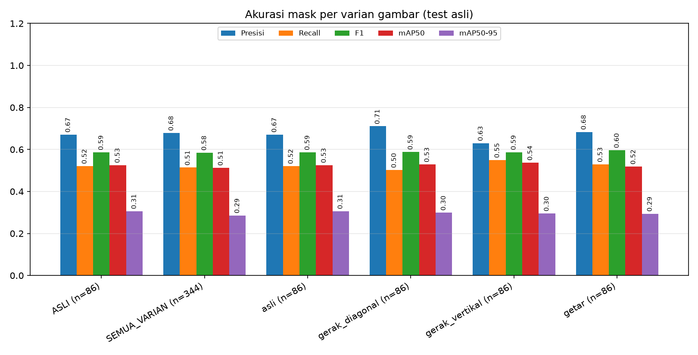 | 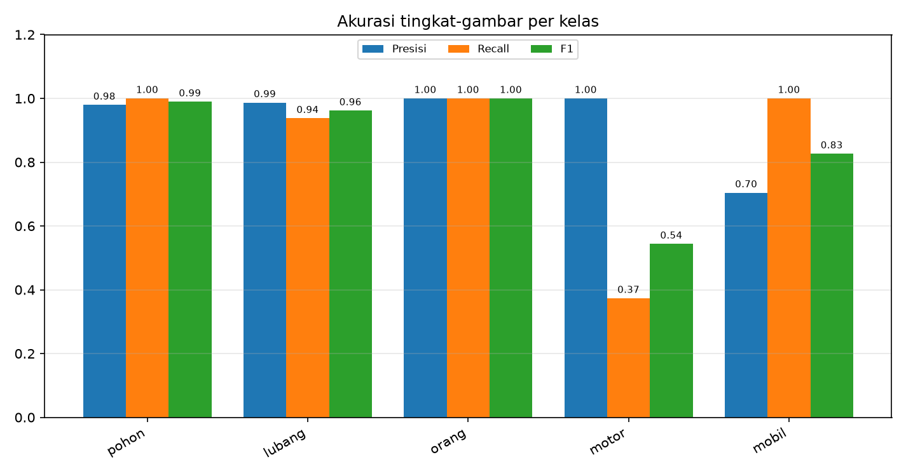 |

| Confusion matrix | Kurva PR mask | Kurva PR kotak |
|---|---|---|
|  |  | 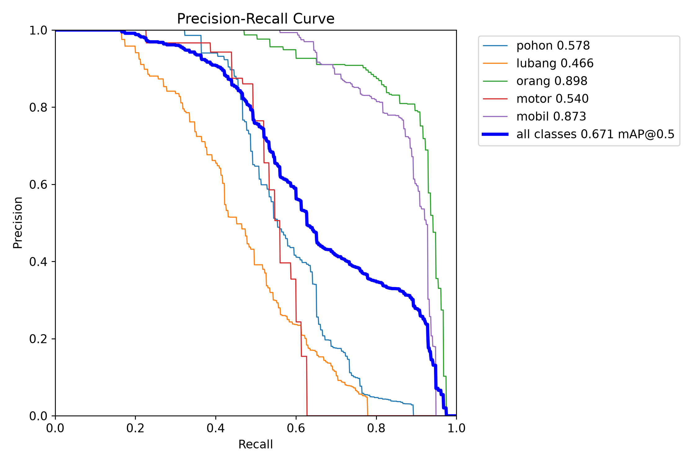 |

### 8.8 Contoh prediksi

| Benar | Salah |
|---|---|
| 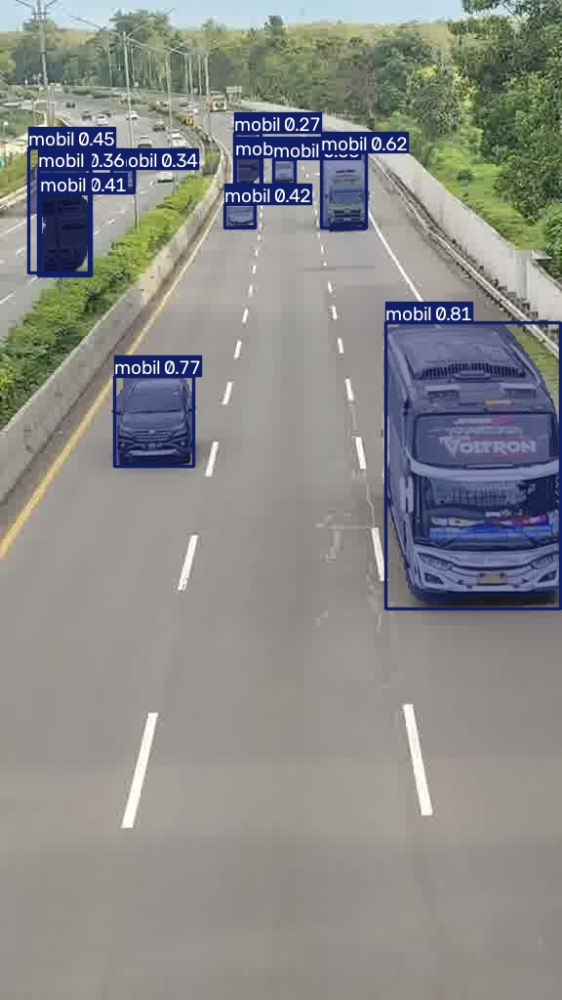 | 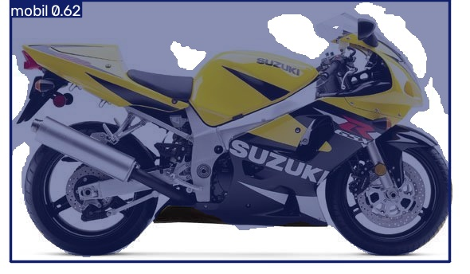 |
| 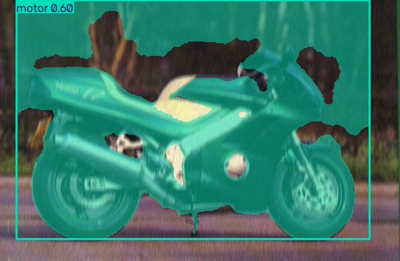 | 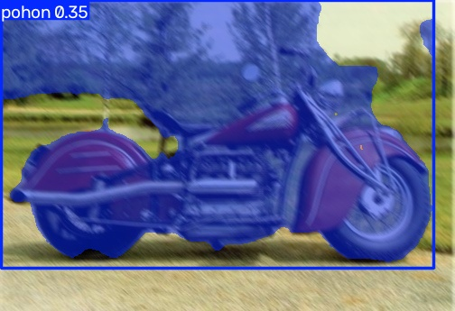 |

Folder lengkap: [`hasil_08/contoh_prediksi/benar/`](hasil_08/contoh_prediksi/benar)
dan [`hasil_08/contoh_prediksi/salah/`](hasil_08/contoh_prediksi/salah).

### 8.9 File hasil tahap 8

| File | Isi |
|---|---|
| [`hasil_08/ringkasan_test.json`](hasil_08/ringkasan_test.json) | skor total, kesalahan gambar, kecepatan |
| [`hasil_08/laporan_akurasi.txt`](hasil_08/laporan_akurasi.txt) | laporan lengkap yang tercetak di layar |
| [`hasil_08/per_kelas.csv`](hasil_08/per_kelas.csv) | metrik mask & kotak per kelas |
| [`hasil_08/per_varian.csv`](hasil_08/per_varian.csv) | metrik per varian gambar |
| [`hasil_08/tingkat_gambar_per_kelas.csv`](hasil_08/tingkat_gambar_per_kelas.csv) | TP/FP/FN, P/R/F1 per kelas |
| [`hasil_08/kesalahan_gambar.csv`](hasil_08/kesalahan_gambar.csv) | daftar 55 gambar yang salah |
| [`hasil_08/kecepatan.json`](hasil_08/kecepatan.json) | statistik kecepatan inferensi |
| [`hasil_08/grafik/`](hasil_08/grafik) | grafik total, per kelas, per varian, tingkat gambar |
| [`hasil_08/evaluasi_val/`](hasil_08/evaluasi_val) | confusion matrix & kurva PR |
| [`hasil_08/contoh_prediksi/`](hasil_08/contoh_prediksi) | contoh prediksi benar/salah |

---

## Tahap 9 (usulan) — Fuzzy Sugeno

[`fuzzysugeno.py`](fuzzysugeno.py) mengubah deteksi YOLO menjadi tingkat urgensi
bahaya 0–100 dari jarak, bahaya kelas, dan porsi mask di jalur. Keluaran:
**AMAN / INFO / WASPADA / BAHAYA**. [`jalankan_fuzzy.py`](jalankan_fuzzy.py)
menjalankan YOLO-seg + fuzzy untuk webcam/gambar/video, termasuk estimasi jarak
monokular dari tinggi bounding box.

> Tahap ini belum dievaluasi kuantitatif karena belum ada ground truth urgensi.
> Jangan mengklaim akurasi fuzzy sampai ada validasi. Detail aturan dan uji cepat:
> [`docs/LAPORAN_LENGKAP.md`](docs/LAPORAN_LENGKAP.md#10-fuzzy-sugeno-usulan-tahap-9).

## Lingkungan

Python 3.12.10 · Ultralytics 8.4.195 · PyTorch 2.14.1+cu126 · NumPy 2.5.4 ·
OpenCV 5.0.0.93 · GPU NVIDIA GeForce GTX 1650 with Max-Q Design.

## Struktur repo

```text
06_bandingkan_model.py          perbandingan 2 model x 3 seed split
07_latih_final.py               latih ulang model final (train+val, val-internal 10%)
08_evaluasi_final.py            evaluasi mendalam model final pada test asli
fuzzysugeno.py                  usulan tahap 9: fuzzy Sugeno untuk urgensi bahaya
jalankan_fuzzy.py               demo YOLO-seg + fuzzy Sugeno (webcam/gambar/video)
hasil_06/                       hasil perbandingan model (CSV, JSON, grafik)
hasil_07/                       hasil latih final (laporan, CSV/JSON, grafik, runs)
hasil_08/                       hasil evaluasi final (laporan, CSV/JSON, grafik, contoh)
models/best.pt                  bobot final hasil tahap 7
runs/segment/hasil_06/          log latih & evaluasi tahap 6
docs/                           laporan lengkap, dataset, galeri, statistik CSV
requirements.txt                dependensi lingkungan
yolo11n-seg.pt, yolo26n-seg.pt  bobot pralatih
```

Dataset besar (`dataset_colab-001/`, gambar/label di `hasil_07/dataset/`,
`hasil_07/_arsip/`) tidak di-commit. Konfigurasi
[`hasil_07/dataset/data.yaml`](hasil_07/dataset/data.yaml) tetap disertakan.

## Cara menjalankan ulang tahap 7 dan 8

```bash
pip install -r requirements.txt

# Tahap 7: latih final (butuh split_r80_s44 dari tahap 5 dan hasil_06)
python 07_latih_final.py --splits-dir <folder_split> --hasil06 hasil_06 \
       --out hasil_07 --models-dir models --epochs 100 --imgsz 416 --batch 1

# Tahap 8: evaluasi mendalam models/best.pt pada test asli
python 08_evaluasi_final.py --splits-dir <folder_split> --hasil07 hasil_07 \
       --model models/best.pt --out hasil_08 --imgsz 416 --batch 1 --conf 0.25
```

Di Colab:

```python
!python 07_latih_final.py --splits-dir /content/dataset --hasil06 /content/hasil_06 \
        --out /content/hasil_07 --models-dir /content/models --epochs 100
!python 08_evaluasi_final.py --splits-dir /content/dataset --hasil07 /content/hasil_07 \
        --model /content/models/best.pt --out /content/hasil_08
```

## Catatan hasil percobaan :

- Tahap 6 baru memakai **3 seed split**; klaim keunggulan yolo26n-seg kuat secara
  arah dan konsistensi, tetapi belum uji statistik formal.
- Tahap 7/8 memakai satu split final (`split_r80_s44`) yang dipilih representatif,
  bukan yang skornya tertinggi.
- Pemecahan per varian `gerak_horizontal` tahap 8 gagal karena satu file sementara
  hilang; evaluasi total 430 gambar tidak terpengaruh.
- Kelas `lubang` dan `motor` masih menjadi titik lemah (mAP50-95 mask 0.2186 dan
  0.1052; recall gambar motor 0.3733) dan menjadi kandidat perbaikan berikutnya.
- Akurasi tingkat gambar hanya membandingkan **himpunan kelas hadir** (conf 0.25),
  bukan jumlah instance, kualitas mask. Metrik utama tetap mask mAP50-95.
- Log `results.csv` latih tahap 7 tidak tersedia; yang ada `args.yaml`,
  `results.png`, dan kurva evaluasi. Tidak ada angka yang direkonstruksi manual.
